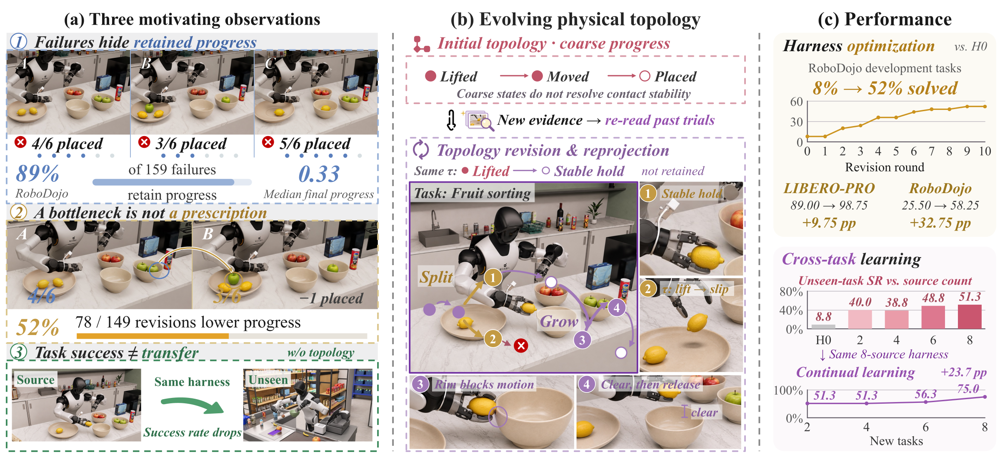

<div align="center">

<p>
  <picture>
    <source media="(prefers-color-scheme: dark)" srcset="docs/assets/logo-april-dark.png">
    
  </picture>
  &nbsp;&nbsp;&nbsp;
  
  &nbsp;&nbsp;&nbsp;
  <picture>
    <source media="(prefers-color-scheme: dark)" srcset="docs/assets/logo-maniformer-dark.png">
    
  </picture>
  &nbsp;&nbsp;
  <picture>
    <source media="(prefers-color-scheme: dark)" srcset="docs/assets/logo-agibot-dark.png">
    
  </picture>
</p>

<h2>Emergent Physical Task Topologies for Embodied Harness Optimization and Cross-Task Meta-Distillation</h2>

<p>
  <a href="https://github.com/xuyicheng-zju">Yicheng Xu</a><sup>1</sup> &nbsp;&middot;&nbsp;
  <a href="https://github.com/Rinke02">Wencan Jiang</a><sup>1</sup> &nbsp;&middot;&nbsp;
  <a href="https://openreview.net/profile?id=~Yuhang_Dong4">Yuhang Dong</a><sup>1</sup> &nbsp;&middot;&nbsp;
  <a href="https://openreview.net/profile?id=~Zihao_Zhu12">Zihao Zhu</a><sup>2,5</sup> &nbsp;&middot;&nbsp;
  <a href="https://openreview.net/profile?id=~Keru_Zhou1">Keru Zhou</a><sup>3</sup><br>
  <a href="https://openreview.net/profile?id=~Chang_Zhou16">Chang Zhou</a><sup>5</sup> &nbsp;&middot;&nbsp;
  <a href="https://openreview.net/profile?id=~Li_Liu19">Li Liu</a><sup>5</sup> &nbsp;&middot;&nbsp;
  <a href="https://openreview.net/profile?id=~Maoqing_Yao1">Maoqing Yao</a><sup>4,5</sup> &nbsp;&middot;&nbsp;
  <a href="https://openreview.net/profile?id=~Yong_Liu11">Yong Liu</a><sup>1</sup> &nbsp;&middot;&nbsp;
  <a href="https://github.com/zhangzjn">Jiangning Zhang</a><sup>1,&dagger;</sup>
</p>

<p>
  <sup>1</sup>Zhejiang University &nbsp;&nbsp;&nbsp;
  <sup>2</sup>Stanford University &nbsp;&nbsp;&nbsp;
  <sup>3</sup>Tsinghua University &nbsp;&nbsp;&nbsp;
  <sup>4</sup>AGIBOT Innovation &nbsp;&nbsp;&nbsp;
  <sup>5</sup>Maniformer<br>
  <sup>&dagger;</sup>Corresponding author
</p>

<p>
  <a href="https://arxiv.org/abs/2611.31053"></a>
  <a href="https://xuyicheng-zju.github.io/ReWeave/"></a>
  <a href="https://github.com/xuyicheng-zju/ReWeave"></a>
  <a href="LICENSE"></a>
  <a href="README.zh-CN.md"></a>
</p>

<p>
  <a href="docs/assets/teaser.png"></a>
</p>

</div>

---

<h2 id="overview">✦ Highlights</h2>

- **Explicit task meta-knowledge.** See which physical conditions a rollout met and where it stalled, then reassess past trials as new evidence comes in.
- **Efficient harness self-evolution.** Reuse earlier trials to diagnose bottlenecks and decide which harness revisions to test next.
- **Shared harness distillation and continual learning.** Distill validated mechanisms from several tasks into one harness, reuse it on unseen tasks, and keep improving it with new trials.

[Read the method](docs/METHOD.md)

<h2 id="quick-start">⚡ Quick Start</h2>

**Python 3.11 or 3.12.** From the repository root, install the package and run
the CPU demo.

```bash
python -m venv .venv
source .venv/bin/activate
python -m pip install -e .
python examples/robodojo_demo.py --output-dir runs/robodojo-demo
```

The CPU demo uses scripted responses and writes `runs/robodojo-demo/demo_summary.json`.
The workflows below use LIBERO-PRO on a Linux GPU. Install the simulator,
model dependencies, and Codex CLI, then set the paths and model for your setup.
[Installation](docs/INSTALLATION.md)

```bash
export REWEAVE_RLINF_ROOT=/path/to/rlinf
export LIBERO_CONFIG_PATH=/path/to/liberopro_config
export PI05_CHECKPOINT_PATH=/path/to/pi05-checkpoint
export SAM3_CHECKPOINT_PATH=/path/to/sam3.pt
export SAM3_BPE_PATH=/path/to/bpe_simple_vocab_16e6.txt.gz
export REWEAVE_MODEL=gpt-6.2-sol
export REWEAVE_CODEX_AUTHOR_MODEL="$REWEAVE_MODEL"
codex login
```

<details>
<summary>Capture the default Harness</summary>

Create a resource manifest for your environment, then capture the baseline once.

```bash
mkdir -p runs
python - <<'PY'
import json
import os
from pathlib import Path

resources = {
    "models": {
        "pi05": os.environ["PI05_CHECKPOINT_PATH"],
        "sam3": os.environ["SAM3_CHECKPOINT_PATH"],
        "sam3_bpe": os.environ["SAM3_BPE_PATH"],
    },
    "environment": {
        "benchmark": "LIBERO-PRO",
        "rlinf_checkout": os.environ["REWEAVE_RLINF_ROOT"],
        "asset_config": os.environ["LIBERO_CONFIG_PATH"],
    },
    "routes": {"planner": os.environ["REWEAVE_MODEL"], "pi05": "local", "sam3": "local"},
}
if "PI05_NORM_STATS_PATH" in os.environ:
    resources["models"]["pi05_norm_stats"] = os.environ["PI05_NORM_STATS_PATH"]
Path("runs/runtime_resources.json").write_text(json.dumps(resources, indent=2) + "\n")
PY
```

```bash
python scripts/capture_harness.py --model "$REWEAVE_MODEL" \
  --resources runs/runtime_resources.json --output-dir runs/H0
```

</details>

### Inference

Select a Harness and run one task. The rollout receipt contains the simulator verdict and can be selected for optimization.

```bash
python scripts/run_inference.py --harness runs/H0/harness.json \
  --task 0 --output-dir runs/task0-trial
```

### Optimization

Select the starting Harness and the development trajectories from one task. Repeat `--trajectory` to include more receipts. One offline mutation writes an unmeasured candidate to `runs/H1-task0/harness.json`.

```bash
python scripts/self_evolve.py --harness runs/H0/harness.json \
  --trajectory runs/task0-trial/attempt/result.json --output-dir runs/H1-task0
```

<details>
<summary>Prepare a second source Harness for distillation</summary>

```bash
python scripts/run_inference.py --harness runs/H0/harness.json \
  --task 1 --output-dir runs/task1-trial
python scripts/self_evolve.py --harness runs/H0/harness.json \
  --trajectory runs/task1-trial/attempt/result.json --output-dir runs/H1-task1
```

</details>

### Distillation

Select the source Harnesses to merge once, with one source per task. The first input provides the starting implementation. The result is `runs/Hshared/harness.json`.

```bash
python scripts/distill.py \
  --harness runs/H1-task0/harness.json --harness runs/H1-task1/harness.json \
  --output-dir runs/Hshared
```

### Continual Learning

Select any compatible Harness as H0. Each `--stage` introduces one batch of tasks. This example learns task 2 first, then tasks 3 and 4 together.

```bash
python scripts/continual_learning.py --h0 runs/Hshared/harness.json \
  --stage 2 --stage 3 4 --output-dir runs/continual
```

Each stage publishes `runs/continual/stream/updates/NNN/harness.json`. Pass that file to `--harness` for inference or to `--h0` to start a new stream. Add `--test-reset-id 1` to evaluate the stage checkpoints on a fixed held-out reset.

<h2 id="documentation">📚 Documentation</h2>

| Guide | Coverage |
| --- | --- |
| [Installation](docs/INSTALLATION.md) | Python, model providers, and simulator dependencies |
| [Usage and evaluation](docs/EVALUATION.md) | Recovery, custom protocols, and held-out evaluation |
| [Method](docs/METHOD.md) | The C/W/L runtime, topology revision, and cross-task distillation |
| [Example protocols](examples/graph_evolution/) | Development conditions, author policy, and graph inputs |

<h2 id="repository">Repository</h2>

```text
reweave/
  runtime/                 C/W/L execution and validation
  evolution/
    graph/                 Topology revision and history reprojection
    search/                Candidate search and evaluation
    distillation/          Shared harness construction
  benchmarks/              LIBERO and RoboDojo adapters
scripts/                   Inference, optimization, distillation, and continual learning
examples/                  CPU demo and example protocols
tests/                     Runtime, method, and adapter tests
third_party/               Upstream links and source attribution
```

<h2 id="citation">Citation</h2>

The paper is available as [arXiv:2611.31053](https://arxiv.org/abs/2611.31053).

```bibtex
@misc{xu2026reweave,
  title         = {ReWeave: Emergent Physical Task Topologies for Embodied Harness Optimization and Cross-Task Meta-Distillation},
  author        = {Yicheng Xu and Wencan Jiang and Zihao Zhu and Keru Zhou and Chang Zhou and Li Liu and Maoqing Yao and Yong Liu and Jiangning Zhang},
  year          = {2026},
  eprint        = {2611.31053},
  archivePrefix = {arXiv},
  primaryClass  = {cs.RO},
  url           = {https://arxiv.org/abs/2611.31053}
}
```

<h2 id="acknowledgments">Acknowledgments</h2>

ReWeave builds on RPent and RLinf for embodied execution, LIBERO-PRO and RoboDojo
for simulation benchmarks, and OpenPI, SAM3, and GraspGen-X for policy and
perception services. Source adaptations and upstream terms are documented in
[third-party components](third_party/README.md).

<h2 id="license">License</h2>

ReWeave code and documentation are licensed under [Apache-2.0](LICENSE).
