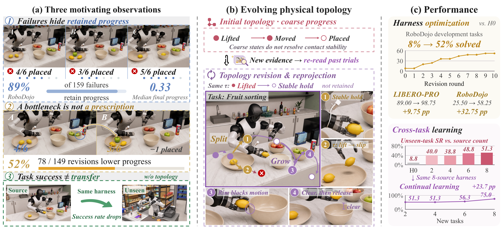

<div align="center">

<p>
  <picture>
    <source media="(prefers-color-scheme: dark)" srcset="docs/assets/logo-april-dark.png">
    
  </picture>
  &nbsp;&nbsp;&nbsp;&nbsp;
  <picture>
    <source media="(prefers-color-scheme: dark)" srcset="docs/assets/logo-maniformer-dark.png">
    
  </picture>
  &nbsp;&nbsp;&nbsp;&nbsp;
  <picture>
    <source media="(prefers-color-scheme: dark)" srcset="docs/assets/logo-agibot-dark.png">
    
  </picture>
</p>

<h3>: Emergent Physical Task Topologies<br>for Embodied Harness Optimization and Cross-Task Meta-Distillation</h3>

<p>
  <a href="https://github.com/xuyicheng-zju">Yicheng&nbsp;Xu</a><sup>1</sup> ·
  <a href="https://github.com/Rinke02">Wencan&nbsp;Jiang</a><sup>1</sup> ·
  <a href="https://openreview.net/profile?id=~Yuhang_Dong4">Yuhang&nbsp;Dong</a><sup>1</sup> ·
  <a href="https://openreview.net/profile?id=~Zihao_Zhu12">Zihao&nbsp;Zhu</a><sup>2,5</sup> ·
  <a href="https://openreview.net/profile?id=~Keru_Zhou1">Keru&nbsp;Zhou</a><sup>3</sup><br>
  <a href="https://openreview.net/profile?id=~Chang_Zhou16">Chang&nbsp;Zhou</a><sup>5</sup> ·
  <a href="https://openreview.net/profile?id=~Li_Liu19">Li&nbsp;Liu</a><sup>5</sup> ·
  <a href="https://github.com/Sundrops">Guanghui&nbsp;Ren</a><sup>4</sup> ·
  <a href="https://openreview.net/profile?id=~Maoqing_Yao1">Maoqing&nbsp;Yao</a><sup>4,5</sup> ·
  <a href="https://openreview.net/profile?id=~Yong_Liu11">Yong&nbsp;Liu</a><sup>1</sup> ·
  <a href="https://github.com/zhangzjn">Jiangning&nbsp;Zhang</a><sup>1,†</sup>
</p>

<p>
  <sub>
    <sup>1</sup>&nbsp;浙江大学 ·
    <sup>2</sup>&nbsp;斯坦福大学 ·
    <sup>3</sup>&nbsp;清华大学 ·
    <sup>4</sup>&nbsp;智元机器人 ·
    <sup>5</sup>&nbsp;Maniformer
    <br>† 通讯作者
  </sub>
</p>

<p>
  <a href="https://arxiv.org/abs/2611.31053"></a>
  <a href="https://xuyicheng-zju.github.io/ReWeave/"></a>
  <a href="https://github.com/xuyicheng-zju/ReWeave"></a>
</p>

<p>
  <a href="docs/assets/teaser.png"></a>
</p>

</div>

---

<h2 id="overview">✦ 亮点</h2>

- **显化的 Meta。** 在任务拓扑上看清每次执行满足了哪些物理条件、卡在哪一步，并在获得新证据后重评旧试验。
- **高效的自进化。** 复用历史试验定位瓶颈，优先验证有证据支撑的 Harness 修改。
- **共享 Harness 的蒸馏与持续学习。** 将多个任务验证过的机制蒸馏成一个共享 Harness，在未见任务上复用，并从新试验中继续改进。

[查看方法说明](docs/METHOD.md)

<h2 id="quick-start">⚡ 快速开始</h2>

**Python 3.11 或 3.12。** 在仓库根目录安装并运行 CPU 示例。

```bash
python -m venv .venv
source .venv/bin/activate
python -m pip install -e .
python examples/robodojo_demo.py --output-dir runs/robodojo-demo
```

CPU 示例使用脚本化响应，结果见 `runs/robodojo-demo/demo_summary.json`。
下文使用 Linux GPU 运行 LIBERO-PRO。安装仿真器、模型依赖与 Codex CLI 后，换成自己的路径和模型。[安装指南](docs/INSTALLATION.md)

```bash
export REWEAVE_RLINF_ROOT=/path/to/rlinf
export LIBERO_CONFIG_PATH=/path/to/liberopro_config
export PI05_CHECKPOINT_PATH=/path/to/pi05-checkpoint
export SAM3_CHECKPOINT_PATH=/path/to/sam3.pt
export SAM3_BPE_PATH=/path/to/bpe_simple_vocab_16e6.txt.gz
export REWEAVE_MODEL=gpt-6.2-sol
export REWEAVE_CODEX_AUTHOR_MODEL="$REWEAVE_MODEL"
codex login
```

<details>
<summary>准备默认 Harness</summary>

先生成当前环境的资源清单，再一次性捕获基线。

```bash
mkdir -p runs
python - <<'PY'
import json
import os
from pathlib import Path

resources = {
    "models": {
        "pi05": os.environ["PI05_CHECKPOINT_PATH"],
        "sam3": os.environ["SAM3_CHECKPOINT_PATH"],
        "sam3_bpe": os.environ["SAM3_BPE_PATH"],
    },
    "environment": {
        "benchmark": "LIBERO-PRO",
        "rlinf_checkout": os.environ["REWEAVE_RLINF_ROOT"],
        "asset_config": os.environ["LIBERO_CONFIG_PATH"],
    },
    "routes": {"planner": os.environ["REWEAVE_MODEL"], "pi05": "local", "sam3": "local"},
}
if "PI05_NORM_STATS_PATH" in os.environ:
    resources["models"]["pi05_norm_stats"] = os.environ["PI05_NORM_STATS_PATH"]
Path("runs/runtime_resources.json").write_text(json.dumps(resources, indent=2) + "\n")
PY
```

```bash
python scripts/capture_harness.py --model "$REWEAVE_MODEL" \
  --resources runs/runtime_resources.json --output-dir runs/H0
```

</details>

### Inference

选一个 Harness 跑一局。回执记录仿真器判定，也可作为自进化的轨迹输入。

```bash
python scripts/run_inference.py --harness runs/H0/harness.json \
  --task 0 --output-dir runs/task0-trial
```

### Optimization

选定起始 Harness 和同一任务的开发轨迹。重复传入 `--trajectory` 可选多条轨迹。离线演化一次，生成尚未评测的 `runs/H1-task0/harness.json`。

```bash
python scripts/self_evolve.py --harness runs/H0/harness.json \
  --trajectory runs/task0-trial/attempt/result.json --output-dir runs/H1-task0
```

<details>
<summary>为蒸馏准备第二个源 Harness</summary>

```bash
python scripts/run_inference.py --harness runs/H0/harness.json \
  --task 1 --output-dir runs/task1-trial
python scripts/self_evolve.py --harness runs/H0/harness.json \
  --trajectory runs/task1-trial/attempt/result.json --output-dir runs/H1-task1
```

</details>

### Distillation

选定要合并的 Harness，每个任务选一个来源。第一个输入是合并的起始实现。合并一次，得到 `runs/Hshared/harness.json`。

```bash
python scripts/distill.py \
  --harness runs/H1-task0/harness.json --harness runs/H1-task1/harness.json \
  --output-dir runs/Hshared
```

### Continual Learning

任意兼容的 Harness 都可以选作 H0。每个 `--stage` 指定一批新任务。这里先学习任务 2，再一起学习任务 3 和 4。

```bash
python scripts/continual_learning.py --h0 runs/Hshared/harness.json \
  --stage 2 --stage 3 4 --output-dir runs/continual
```

每个阶段产出 `runs/continual/stream/updates/NNN/harness.json`。通过 `--harness` 可选它做推理，通过 `--h0` 可从它开启下一轮持续学习。加上 `--test-reset-id 1`，可在同一留出条件下评测各阶段。

<h2 id="documentation">📚 文档</h2>

| 文档 | 内容 |
| --- | --- |
| [安装](docs/INSTALLATION.md) | Python 环境、模型服务和仿真依赖 |
| [使用与评测](docs/EVALUATION.md) | 恢复运行、自定义协议和留出评测 |
| [方法](docs/METHOD.md) | C/W/L 运行时、拓扑更新和跨任务蒸馏 |
| [示例协议](examples/graph_evolution/) | 开发条件、作者配置和拓扑分析输入 |

<h2 id="benchmarks">基准</h2>

| 后端 | 单局条件 |
| --- | --- |
| LIBERO-PRO | 任务套件、任务编号、随机种子和复位状态 ID |
| RoboDojo | 任务名称、布局集合和布局 ID |

单局结果以环境评估器的判定为准。[评测说明](docs/EVALUATION.md)

<h2 id="repository">代码结构</h2>

```text
reweave/
  runtime/                 C/W/L 执行与校验
  evolution/
    graph/                 拓扑修订与历史重投影
    search/                候选 Harness 搜索与评估
    distillation/          共享 Harness 构建
  benchmarks/              LIBERO 和 RoboDojo 适配器
scripts/                   推理、自进化、蒸馏与持续学习
examples/                  CPU 示例与示例协议
tests/                     运行时、方法和适配器测试
third_party/               上游链接与源码归属
```

<h2 id="citation">引用</h2>

论文已发布于 [arXiv:2611.31053](https://arxiv.org/abs/2611.31053)。

```bibtex
@misc{xu2026reweave,
  title         = {ReWeave: Emergent Physical Task Topologies for Embodied Harness Optimization and Cross-Task Meta-Distillation},
  author        = {Yicheng Xu and Wencan Jiang and Zihao Zhu and Keru Zhou and Chang Zhou and Li Liu and Maoqing Yao and Yong Liu and Jiangning Zhang},
  year          = {2026},
  eprint        = {2611.31053},
  archivePrefix = {arXiv},
  primaryClass  = {cs.RO},
  url           = {https://arxiv.org/abs/2611.31053}
}
```

<h2 id="acknowledgments">致谢</h2>

ReWeave 使用 RPent 和 RLinf 的具身执行组件，使用 LIBERO-PRO 和 RoboDojo 作为仿真基准，并接入 OpenPI、SAM3 和 GraspGen-X 提供策略与感知服务。[上游组件与源码归属](third_party/README.md)

<h2 id="license">许可证</h2>

ReWeave 代码与文档采用 [Apache-2.0](LICENSE) 许可证。
